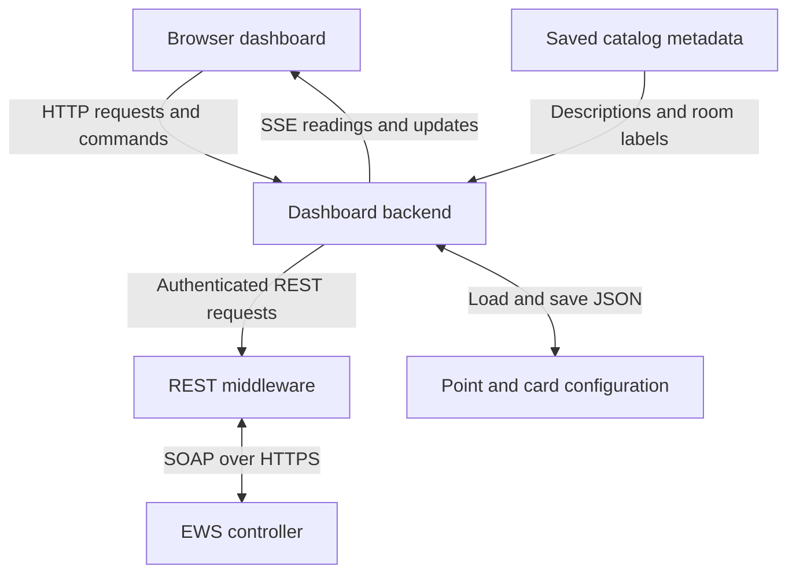

# IoT Electric

IoT Electric contains two small services: a REST middleware for Schneider EcoStruxure Web Services (EWS) and a browser dashboard for live PLC values.

## What runs where

| Service | Folder | Local URL | Purpose |
| --- | --- | --- | --- |
| Middleware | `middleware/` | `http://localhost:3000` | Converts EWS/SOAP operations into a REST API |
| Dashboard | `dashboard/` | `http://localhost:3001` | Polls the middleware and displays live point values |

The middleware exposes public health and Swagger pages at `/health` and `/api-docs`. All `/api/*` endpoints require HTTP Basic authentication. Open Swagger and use **Authorize** before trying an API endpoint.

## Architecture

The dashboard backend holds the middleware credentials and shares one live-value poller across connected browsers. Browser actions use HTTP requests; readings and configuration changes arrive through Server-Sent Events (SSE).



Live values are cached in dashboard memory. The dashboard stores configuration, user accounts and room permissions in `dashboard.sqlite` on the mounted configuration volume. The separate SQLite building catalog supports offline inventory and export. History and alarms are requested from the controller through the middleware.

See the dashboard diagrams for [live refresh](dashboard/README.md#live-refresh), [device-card grouping](dashboard/README.md#experimental-device-cards), [command validation](dashboard/README.md#device-command-flow), and [automatic discovery](dashboard/README.md#automatic-discovery-flow).

## EWS container discovery

`GET /api/containers?id=...` reads a container and automatically follows EWS continuation pages. Repeated container headers are combined; child containers, values, histories and alarms are merged by their exact, case-sensitive IDs. The existing `containers` and `errors` arrays remain available. History/alarm items retain their original `Id`/`Name` field names.

The response also includes `pagesRead`, `status` and `complete`. `status` contains `moreDataAvailable` and the exact string `moreDataRef` from the last successful page, or is `null` when absent. An unsafe continuation is cleared when the item limit truncates a page. `complete` is `true` only after an explicit final paging flag and no item errors, `false` for a partial result or an error, and `null` when the server did not provide its paging flag. Completion covers this container request, not the entire server tree. Some EBO servers omit paging status even in EWS 1.2 responses.

Add `metadata=true` to request optional EWS metadata. Container and value metadata is returned as `metadata` without flattening categories/properties or converting their string values. Metadata returned on history/alarm items remains under `Metadata`. An unsupported metadata request is reported as a fault. Metadata is not requested by default and the dashboard does not yet use it to classify devices.

For page-by-page inspection use `allPages=false`. To resume, URL-encode `status.moreDataRef` and send it as the `moreDataRef` query parameter with the same `id` and `metadata` setting. Preserve whitespace, leading zeros, case and special characters in the token. A resumed response covers the requested suffix, not pages read by a previous request.

If a later page fails, the middleware returns the collected items with an error and `complete=false`; HTTP 200 alone does not imply a complete result. A first-page SOAP fault uses HTTP 502, and a timeout before the first page uses 504. Missing or repeated continuation tokens stop aggregation with an error. Each call is bounded to 100 pages and 50,000 returned items, counting container headers and all item types. An item-limit stop may occur within a page, so that page cannot be resumed by token alone; narrow the container request when this limit is reported.

`EWS_CONTAINER_TIMEOUT_MS` sets the total controller-read budget, including authentication and every page (default 8000 ms). Keep the dashboard's `DASHBOARD_MIDDLEWARE_TIMEOUT_MS` comfortably above it (default 10000 ms). The deadline aborts the controller fetch and returns any already collected pages. For larger installations, use individual pages or increase both budgets together.

`EWS_REQUEST_TIMEOUT_MS` limits every other controller call, including writes (default 30000 ms). The middleware also stops a controller call as soon as the REST client that asked for it disconnects or times out, so a request the dashboard already gave up on does not keep waiting on the controller. A write that was cut off this way may or may not have reached the controller; check the actual state. Known issues that were deliberately left open are listed in [docs/known-issues.md](docs/known-issues.md).

## Repository layout

For a large-building inventory independent of the dashboard, use the [offline topology mapper](tools/ews-topology/README.md). It saves every EWS page to a resumable checkpoint and exports JSON/CSV for inspection and the existing widget grouping preview.

Import its checkpoint into the [SQLite building catalog](tools/building-catalog/README.md) with `npm run catalog -- import`. The catalog stores discovered containers, points, graph links, device groups and recognized functions in a separate database, supports local search and snapshot history, and makes no EWS requests.

```text
.
├── middleware/                  # Express app, EWS client, API routes and OpenAPI document
├── dashboard/                   # Independent PLC widget service and browser UI
├── catalog/                     # SQLite building catalog, topology import and read/search layer
├── test/                        # Middleware tests
├── scripts/                     # Repository maintenance helpers
├── tools/
│   ├── building-catalog/        # Offline catalog import and search CLI
│   ├── ews-topology/            # Resumable Python topology mapper with JSON/CSV exports
│   ├── gpa-translator/           # Gira project name/status translator and review UI
│   └── knx-extractor/            # KNX project extraction utility and legacy fixtures
├── projects/                    # Ignored local GPA/KNX input projects
├── output/                      # Ignored generated files, grouped by tool
├── docs/local/                  # Ignored local guides
├── .github/workflows/           # Test and Docker image automation
├── Dockerfile                   # Middleware image
├── docker-compose.yml           # Local/test build
└── docker-compose.portainer.yml # Deployment with published images
```

Local `.env`, `projects/`, `docs/local/`, `*.knxproj`, `output/`, and dependency folders are intentionally ignored. They contain credentials, local project data, generated files, or installed packages and should not be committed.

Local project inputs are organized as follows:

- `projects/gpa/reference/`: original R1-13 English/Croatian reference archives.
- `projects/gpa/blocks/R1/`: the supplied apartment block archives.
- `projects/gpa/extracted/`: previously unpacked reference projects.
- `projects/knx/`: KNX source projects.
- `output/gpa-translator/`: `releases/`, `translated/`, `tests/`, and `reports/`.
- `output/knx-extractor/`: extracted KNX XML and settings.
- `docs/local/UPUTE.html`: local setup and release guide.

See [tools/gpa-translator/README.md](tools/gpa-translator/README.md) for the GPA tool.

For new Portainer instances, see [Docker images and Portainer](#docker-images-and-portainer). The optional [tools/stack-setup/README.md](tools/stack-setup/README.md) helper prepares an instance folder for the Docker Compose CLI.

## Start locally with Docker

1. Copy `.env.example` to `.env`.
2. Install the local development and test dependencies, then generate middleware credentials:

   ```sh
   npm ci
   npm ci --prefix dashboard
   npm run auth:generate
   ```

3. Put the generated `MIDDLEWARE_USER` and `MIDDLEWARE_PASSWORD_HASH` in `.env`. Save the displayed plaintext password in a password manager; it cannot be recovered from the hash.
4. Add the controller connection:

   ```env
   EWS_URL=https://controller.example/EcoStruxure/DataExchange
   EWS_USER=controller_username
   EWS_PASSWORD=controller_password
   ```

5. Add your [dashboard account credentials](dashboard/README.md#dashboard-accounts) to `.env`, then start both services:

   ```sh
   docker compose up --build
   ```

Open `http://localhost:3000/api-docs` for the API or `http://localhost:3001` for the dashboard. Demo mode is enabled by default. See the [dashboard storage and migration instructions](dashboard/README.md#dashboard-storage) to carry over existing settings.

Each service uses its own credentials:

- `EWS_USER` and `EWS_PASSWORD` let the middleware connect to a DDC controller.
- `MIDDLEWARE_USER` and its generated password let Swagger, Postman, or the dashboard call the REST API.
- The dashboard administrator signs in from a browser and manages regular accounts and room access on **Admin**.

The dashboard needs the middleware's plaintext password because it is an API client. Keep it only in the untracked `.env`, a Portainer secret, or a Docker secret. Compose injects credentials at container start; they are not baked into either image. The Portainer stack can instead generate the password into its `middleware-credentials` volume (see [New Portainer stack](#new-portainer-stack)). To replace a generated password, delete `/run/iot-electric/middleware-password` in the middleware container, then restart the middleware and afterwards the dashboard, which reads the password only at startup.

## Useful commands

| Command | Purpose |
| --- | --- |
| `npm start` | Start the middleware |
| `npm run dev` | Start the middleware with file watching |
| `npm test` | Run middleware, tool, and dashboard tests |
| `npm run test:middleware` | Run only middleware tests |
| `npm run test:tools` | Run only development-tool tests |
| `npm run test:dashboard` | Run only dashboard tests |
| `npm run auth:generate` | Generate middleware login credentials |
| `npm run knx:extract -- project.knxproj` | Extract a KNX project into ignored `output/knx-extractor/` |
| `npm run catalog -- import` | Import the saved topology checkpoint into the SQLite building catalog |
| `npm run catalog -- summary` | Inspect catalog coverage, device types and recognized functions |

For a non-Docker dashboard preview, install its dependencies with `npm ci --prefix dashboard` and run `npm start --prefix dashboard`.

## Docker images and Portainer

GitHub Actions tests the repository and builds both images:

- `ghcr.io/b-mikulan/iot-electric`
- `ghcr.io/b-mikulan/iot-electric-dashboard`

A push to `main`, a pull request targeting `main`, or a manual workflow run only runs tests and validates Compose files. Docker images are built and published only when a Git version tag matching `v*.*.*` (for example `v1.0.0`) is pushed, after the tests pass. For a stable deployment, use the same exact version for both services:

```sh
git tag v1.0.0
git push origin v1.0.0
```

### New Portainer stack

Portainer pulls the published images directly, so the server needs no Git clone, manual build or preparation script.

1. **Stacks → Add stack**. Choose **Repository** with this repository's URL and the Compose path `docker-compose.portainer.yml`, or paste that file into **Web editor**.
2. Add the environment variables:

   ```env
   IMAGE_TAG=1.0.0
   EWS_URL=https://controller.example/EcoStruxure/DataExchange
   EWS_USER=controller_username
   EWS_PASSWORD=controller_password
   DASHBOARD_ADMIN_USER=admin
   DASHBOARD_ADMIN_PASSWORD=choose_a_password
   # Only when another stack on the same Docker host already uses 3000/3001:
   # MIDDLEWARE_HOST_PORT=3100
   # DASHBOARD_HOST_PORT=3101
   ```

3. **Deploy the stack**, then sign in to the dashboard as the administrator and add points through discovery.

The stack sets up the rest on its first start:

- Without `MIDDLEWARE_PASSWORD_HASH`, the middleware creates a random password for the user `iot-electric` in the `middleware-credentials` volume. The dashboard reads it from there, and the dashboard starts only after the middleware is healthy. The password is kept across restarts and image updates. For Swagger or Postman access, read `/run/iot-electric/middleware-password` through the middleware container's Portainer console, or set your own `MIDDLEWARE_USER`, `MIDDLEWARE_PASSWORD_HASH` and `DASHBOARD_MIDDLEWARE_PASSWORD`, which always take precedence.
- The dashboard keeps its database in the `dashboard-config` volume and starts with no points.
- Demo mode is off by default in this file; set `DASHBOARD_DEMO_MODE=true` for a demo stack. The dashboard waits for a healthy middleware, so a demo stack still needs `EWS_URL`, `EWS_USER` and `EWS_PASSWORD`; placeholder values are enough because demo mode never calls the middleware. `EWS_URL` has no default, so a missing value stops the deployment with an error instead of connecting to another controller.
- The administrator exists only through `DASHBOARD_ADMIN_USER` and `DASHBOARD_ADMIN_PASSWORD`; keep them in the stack after the first start.

Behind HTTPS also set `DASHBOARD_SECURE_COOKIES=true`, and behind a reverse proxy `DASHBOARD_TRUST_PROXY=1` (see [Security status](#security-status)). A controller with a different certificate authority still needs that CA in the middleware image. Private GHCR packages require read-only package credentials in Portainer.

Automatic middleware credentials need images from the release that introduced them; older images stop with a missing `MIDDLEWARE_PASSWORD_HASH` error. Existing stacks that rely on the former `EWS_URL` or demo-mode defaults must set those variables before redeploying with this file.

## Security status

Middleware password verification uses asynchronous scrypt. Each middleware process permits at most two concurrent password checks and 60 new checks per minute across clients. A client address can make up to 20 failed or pending attempts per minute; an incorrect username counts too. Limits return HTTP 429 with `Retry-After`, and the client-tracking map is bounded to 1,000 addresses. Requests without Basic credentials receive the usual HTTP 401 challenge.

Successfully verified credentials are remembered for five minutes as a keyed fingerprint, so routine dashboard polling avoids repeated password derivation and can continue during throttling. No plaintext password is stored in this cache. The configured account/hash stays fixed for the process lifetime; restart the middleware after rotating credentials. The limits and cache are process-local, so multiple replicas have separate budgets. Health and Swagger pages remain outside authentication limits. Behind a reverse proxy, clients share its socket address unless trusted-proxy handling is explicitly configured; do not blindly trust incoming `X-Forwarded-For` headers.

The current Compose configuration is intended for an isolated test server. Use HTTPS for both services in production and set `DASHBOARD_SECURE_COOKIES=true` for the dashboard. Behind a reverse proxy also set `DASHBOARD_TRUST_PROXY` (and `MIDDLEWARE_TRUST_PROXY` if the middleware is proxied) to the number of proxy hops, usually `1`; otherwise all clients share the proxy's address and one person's failed logins throttle everyone.

The middleware image installs the project CA certificate from `middleware/root_certificate_iotelectric.crt`. Replace it when the target controller uses a different CA. If no private CA is needed, remove the certificate `COPY`, `update-ca-certificates`, and `NODE_EXTRA_CA_CERTS` lines from the Dockerfile together.
