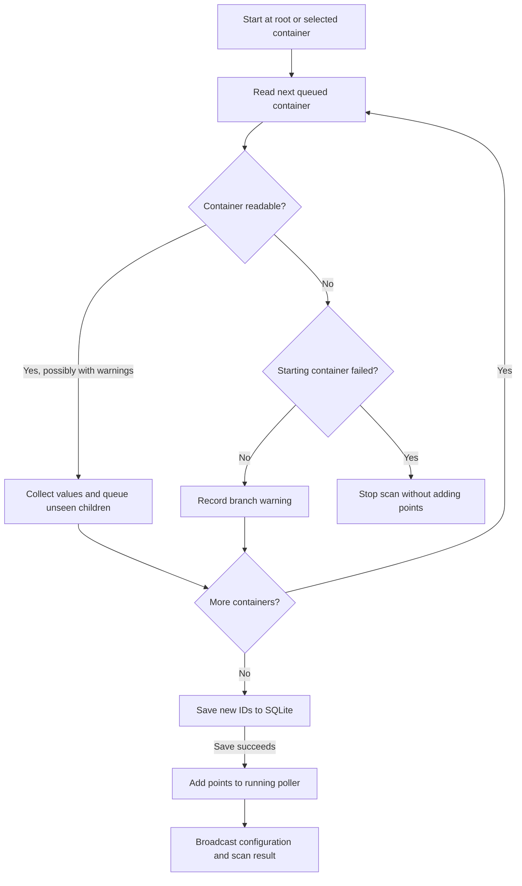
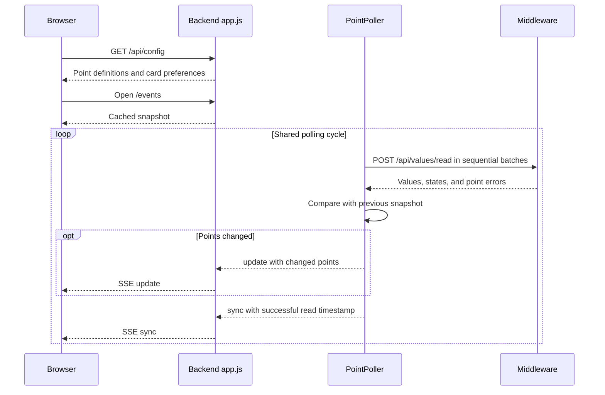
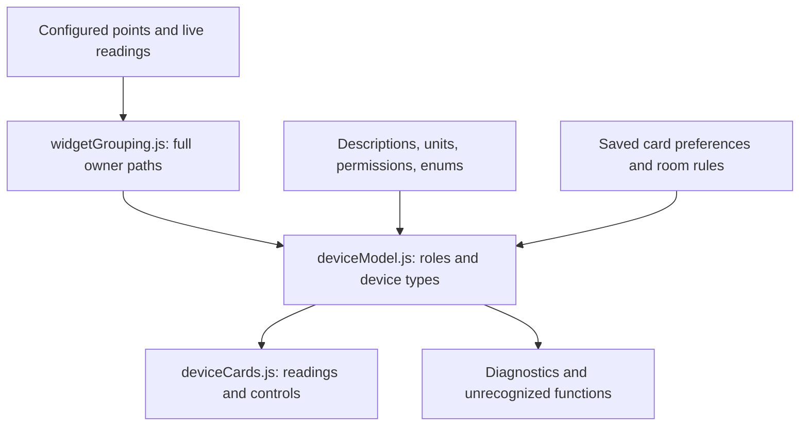
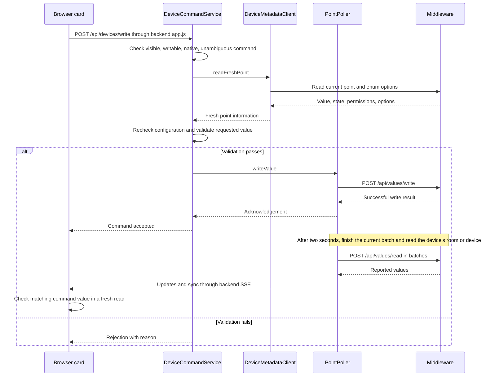

# IoT Electric PLC dashboard

This is the second, independent Node.js service. It polls the protected DDC middleware, detects changed values with `EventEmitter`, and pushes only those changes to open browsers over Server-Sent Events. The browser never receives the middleware username or password.

For end users, see the [Croatian dashboard user guide](../docs/korisnicke-upute-dashboard.html). It is a standalone HTML file with embedded screenshots, image zoom and print/PDF styling; it can be opened offline and shared as one file.

## Source layout

- `public/pages/` contains the HTML entry points. Frontend assets are grouped under `public/dashboard/`, `public/devices/`, `public/admin/`, `public/trends/`, `public/transfer/` and `public/shared/`.
- `lib/auth/` handles accounts, sessions and room access. `lib/devices/` handles device commands, metadata and room organization.
- `lib/telemetry/` handles polling, history and refresh scopes. `lib/storage/` holds SQLite, the configuration stores and import/export.
- `lib/http/` serves the existing asset URLs and writes Server-Sent Events.

## Quick preview

```sh
cp .env.example .env
npm install
npm start
```

Set your dashboard credentials in `.env`, then open `http://localhost:3001` and sign in. Demo mode is enabled by default and is visibly marked in the interface.

## Dashboard accounts

Set the following variables in the dashboard's local `.env`, the repository-root `.env` for Docker Compose, or the Portainer stack environment.

| Account | Username variable | Password variable |
| --- | --- | --- |
| Administrator | `DASHBOARD_ADMIN_USER` | `DASHBOARD_ADMIN_PASSWORD` |

Sign in as the administrator and open **Admin** to add, rename or delete dashboard users, change their passwords and choose which rooms each user can view. New users start with no rooms selected. **Sve prostorije i uređaji bez prostorije** also includes future rooms and devices without an assigned room. Regular accounts can view their permitted rooms and live readings. Device commands, configuration, discovery, trends, alarms and backup operations require the administrator. Updating or deleting an account ends its active sessions. Sessions also expire after 12 hours or when the dashboard process restarts.

Regular accounts, room IDs and scrypt password hashes are stored in SQLite. Existing `DASHBOARD_LOGIN_USER` and `DASHBOARD_LOGIN_PASSWORD` can seed a regular account with read access to all rooms if there is no legacy users file. This happens once, when the database is initialized.

For HTTPS deployments, set `DASHBOARD_SECURE_COOKIES=true` so browsers send the session cookie only over HTTPS.

## Dashboard storage

Docker Compose and Portainer use `/app/config/dashboard.sqlite` on the mounted configuration volume. Local runs use `dashboard.sqlite` beside the configured `WIDGETS_FILE`, or under `dashboard/config/` when no widget file is configured. Override the location with `DASHBOARD_DB_FILE`. The dashboard service must be able to write to that directory. Use a separate database file for each dashboard instance.

On the first start the dashboard imports point definitions, device cards, rooms and floors, room permissions, users, saved polling settings and catalog metadata from the existing configuration. Keep the same volume and legacy file variables for the upgrade. `DASHBOARD_USERS_FILE` selects the old users file if it has a custom location. If present, an interrupted legacy import is recovered before migration. The database takes over after a successful migration, and subsequent edits to the legacy files have no effect.

To move a complete instance including accounts, stop the dashboard and copy `dashboard.sqlite` to the destination volume. Supply the destination's middleware credentials and administrator account through its environment. For a configuration-only transfer, use **Prijenos postavki**.

## Move a dashboard to another server

Open **Prijenos postavki** on the dashboard, or `/transfer.html`.

1. On the source dashboard, click **Preuzmi postavke** to download `dashboard-backup.json`.
2. Deploy the updated dashboard image on the destination server with its own working EWS/middleware connection and a persistent writable configuration volume.
3. Open **Prijenos postavki** on that server, select the downloaded file and review the point, card and room counts. Confirm **Želim primijeniti ovaj prikaz na dashboard**, then click **Uvezi postavke**.

The versioned JSON bundle contains widget definitions, visibility and write flags, card names, room assignments, chosen readings and units, saved device metadata and polling settings. It excludes live values, accounts, credentials and EWS addresses. All open dashboard views reload after import. The poller discards results from any in-flight read of the old configuration and starts a fresh read.

The page also accepts an older `widgets.json` array. That replaces the point list while retaining destination card preferences for matching owners and any available destination metadata. It cannot transfer source room assignments or descriptions; use the full bundle for this building. Imports replace the point set rather than merging it, so deliberately removed duplicate points stay removed. Maximum upload size: 16 MB. If a reverse proxy limits request bodies, allow at least 16 MB there as well.

For Docker Compose or Portainer, set these stack variables (middleware credentials remain configured separately):

```dotenv
DASHBOARD_DEMO_MODE=false
DASHBOARD_DB_FILE=/app/config/dashboard.sqlite
DASHBOARD_POLL_INTERVAL_MS=180000
DASHBOARD_READ_BATCH_SIZE=128
DASHBOARD_READ_BATCH_DELAY_MS=1000
DASHBOARD_MIDDLEWARE_TIMEOUT_MS=30000
```

Both Compose definitions mount `/app/config` read/write. Keep that volume across redeploys. A fresh live deployment can start with an empty database and accept an upload.

Preview validates the entire document. The confirmation token covers both the upload and the current configuration, so an intervening change requires another preview. Import waits for queued storage work and rejects concurrent edits or discovery. SQLite commits the previous configuration backup and the replacement together. To restore the previous configuration, download it using **Preuzmi prethodne postavke** after import, or open `/api/dashboard-transfer/backups/<backup-id>` as administrator, then import that JSON file.

API: `GET /api/dashboard-transfer/status`, `GET /api/dashboard-transfer/export`, `POST /api/dashboard-transfer/preview` with `{document}`, and `POST /api/dashboard-transfer/import` with `{document, token}`.

## Trends and alarms

Open **Trendovi i alarmi** on the dashboard (or `/trends.html`). The page uses locally served [DataTables](https://datatables.net/) for searchable, sortable, paginated tables and [Chart.js](https://www.chartjs.org/) for a history line chart. No CDN access is required in the browser.

Use **Pronađi trend kroz mape kontrolera** to browse from the root or paste a known container ID. Select a history item, choose **Od** and **Do**, then click **Dohvati trend**. A trend has its own EWS history ID; the live value/widget ID is not interchangeable with it. Dates use the browser's local time zone and are sent to EWS in UTC. The graph uses elapsed time on its horizontal axis and displays numeric values; the table retains all records and EWS state codes.

Click **Dohvati alarme** to retrieve the controller's alarm event list. The table includes transition/occurrence timestamps, source, message, priority, raw EWS state, type and identifiers. This view reads alarms only; it does not acknowledge them.

Both views expose **Učitaj još** when EWS returns `MoreDataAvailable`. Each click fetches one additional controller page with `MoreDataRef` and the original query. DataTables pagination/search/sort operate on the rows already fetched. The status explicitly distinguishes partial data from a completed query. A new query clears the previous result; a failed continuation retains the successfully fetched rows and allows retrying. A repeated continuation token stops loading and asks for a new query. History and alarm queries run on demand, independently of live widget polling.

The backend calls the existing middleware `/api/history/query`, `/api/alarms/query`, and `/api/containers` endpoints with the configured middleware credentials; credentials remain on the server. Demo mode supplies clearly labelled synthetic history and one demo alarm without contacting EWS.

### Live verification, 22 September 2026

Read-only checks against the configured EWS controller succeeded through the dashboard and authenticated middleware:

- Container `00/ES/Test4EWS/Trend Logs` exposed two history items: **Multistate Value Interval Trend Log** and **Multistate Value Change of Value Trend Log** (IDs start with `03/ES/Test4EWS/Trend Logs/`).
- Each trend returned **1,441 records over two controller pages** for `2026-09-21T00:00:00Z` through `2026-09-22T00:00:00Z`, with a completed continuation sequence.
- The alarm event query returned **4 alarms**, with no further page.
- Browser verification confirmed history discovery, the real history chart/table, **Učitaj još**, and the real alarm table. These counts describe that check; they are not fixed expected production values.

When running the middleware directly on Windows, use the project CA just as the Docker image does: set `NODE_EXTRA_CA_CERTS` to the absolute path of `middleware/root_certificate_iotelectric.crt` before starting Node. TLS verification remains enabled.

## Connect real PLC points with Docker Compose

To seed a new database from sample widget definitions, create a local file and set `WIDGETS_FILE` before the first start:

```powershell
Copy-Item dashboard/config/widgets.example.json dashboard/config/widgets.json
```

For a previously mapped building, the [building catalog](../tools/building-catalog/README.md#populate-the-dashboard-with-native-points) can populate every native point with `npm run catalog -- widgets --apply` from the repository root. It backs up the current list, keeps settings for native points already present and saves `catalog-metadata.json` beside the widget file. Restart the dashboard after import. Saved descriptors cover the whole catalog without another EWS discovery pass; live value polling still uses the middleware.

`catalog-metadata.json` is detected automatically beside `WIDGETS_FILE` when seeding the database. Set `DEVICE_METADATA_FILE` (Compose: `DASHBOARD_DEVICE_METADATA_FILE`) for a different source. To update an existing database from a new metadata export, export a dashboard backup, replace its `metadata` field with the contents of the catalog export and import the resulting bundle. Without saved catalog metadata, the existing bounded live metadata lookup remains available. Commands still require fresh controller validation.

The device view includes a search field for names, full paths and room labels, a type selector, and expandable room filters. They combine and remain selected as readings update; they only filter the display.

Large buildings can set `READ_BATCH_SIZE` (1–500, default 500) and `READ_BATCH_DELAY_MS` (0–60000, default 0). Compose forwards `DASHBOARD_READ_BATCH_SIZE` and `DASHBOARD_READ_BATCH_DELAY_MS`. Reads remain sequential and retain the 60 KB request-body bound; the delay is idle time between completed batches. A batch failure stops that refresh without automatically retrying it. Choose `POLL_INTERVAL_MS` and `MIDDLEWARE_TIMEOUT_MS` for the building's measured response times. Overlapping refresh ticks share the in-flight cycle, and stopping the poller prevents further batches from being scheduled.

Edit it as normal formatted JSON. Each `id` must match a DDC value identifier accepted by `POST /api/values/read`:

```json
[
  {
    "id": "01/ES/Building/Temperature",
    "label": "Temperatura ureda",
    "description": "Ured · prizemlje",
    "unit": "°C",
    "precision": 1,
    "writable": true
  }
]
```

Then keep only the connection settings in the repository-root `.env`:

```env
DASHBOARD_DEMO_MODE=false
DASHBOARD_MIDDLEWARE_PASSWORD=the_plaintext_middleware_password
DASHBOARD_WIDGETS_FILE=/app/config/widgets.json
```

Local Compose supplies `http://middleware:3000`, the shared `MIDDLEWARE_USER`, and a writable volume for SQLite. The dashboard needs the plaintext password because it is an API client. Keep it in the ignored root `.env` or a Docker secret.

Widgets are read-only by default. A widget appears in the **Postavi vrijednost** dropdown only when it explicitly contains `"writable": true`. The first version accepts finite numeric values and sends them from the dashboard backend to the existing middleware `POST /api/values/write` endpoint, so middleware credentials are never exposed to browser JavaScript. The page asks for confirmation and does not update a card optimistically; the normal poll displays the value reported by the controller.

The current dashboard has no separate user login. Before enabling any writable widget, restrict port `3001` to trusted source addresses or place it behind authenticated HTTPS access. Anyone who can open an unrestricted dashboard could otherwise use its write control.

The round refresh button opens object discovery. An empty search starts at the EWS root, a container ID lists its immediate child containers and values, and a pasted full value ID is resolved through its parent container. Containers can be opened in the result list. **Dodaj** saves a selected value to the database and adds it to the running dashboard immediately. Discovered values are deliberately added as read-only widgets. Enable writing in the widget settings when needed.

**Automatski dodaj sve vrijednosti** recursively scans the whole EWS from the root and saves all discovered value items in one batch. Existing IDs are skipped and keep their labels, visibility, precision and write permissions. Progress is synchronized through SSE; the scan continues on the server if the dialog or browser closes. At completion the dialog displays a collapsible folder/value tree with controller IDs and dashboard membership. Repeat scans add only new values. If an individual branch fails or returns an incomplete response, discovery continues through the other branches, keeps any readable items from partial responses, and adds the values it found. The progress and completion summary count branches with warnings, and their tree entries display a warning and the error details. A root that cannot be read, a persistence failure or a size-limit error still stops the scan. The manual search's 500-result display limit does not apply; automatic discovery stops with an explicit error if it exceeds 10,000 containers or 50,000 values. Only one automatic scan runs at a time. Scan progress and the resulting tree stay available until the dashboard server restarts; saved widgets survive restart.

To scan a specific folder, choose **Automatski dodaj iz ove mape** next to a container in the search results. This recursively adds values from that container and its descendants, using the same persistence, duplicate handling and progress reporting as the root scan. The progress and completion summary show the starting container ID. The original root-scan button remains available. `POST /api/discovery/auto` accepts an optional `containerId`; omitting it or passing an empty string starts at the EWS root. An unreadable starting container stops the scan without adding widgets.

The hamburger button next to discovery controls which configured widgets are shown. Turning a widget off saves its visibility setting, and it can be turned on again at any time. Hidden writable widgets are removed from the write dropdown. Visibility changes are synchronized to other open dashboard pages through SSE.

Widgets appear in collapsible groups based on their owning device's EWS path. For recognized EBO paths, `Values`, `Points` (including Modbus register subfolders), `External Bindings`, `Logs`, `Alarms`, and `Graphics` are organizational branches within one owner. For example, `.../B301/Values/BlndPos` and `.../B301/Points/BlndBtnUp` appear together, as do AC309's input/holding registers and direct device properties. The `01`/`11` prefix is excluded from the group identity only; exact point IDs are retained for controller reads. Group headings show the short device name plus server/controller/zone context, while membership, rename and deletion use the complete owner path. Equal names on different controllers stay separate, including external-binding copies. A `Zones/Z312/Values` aggregate appears as **Zona Z312**, rather than a physical device.

The optional `group` setting overrides automatic grouping and remains unchanged. Unknown path formats keep parent-folder grouping; IDs without a parent folder appear under **PLC vrijednosti**. Grouping does not hide or remove points, combine aliases, classify controls, or enable writing. Hidden widgets do not appear in a group, and a group with no visible widgets is hidden. Group headers show the visible/total count when some widgets are hidden.

### Automatic discovery flow

Discovery runs on the backend independently of the browser connection. It collects readable values before saving new point definitions; existing IDs and their settings are preserved.



Progress is streamed over SSE throughout the scan. Exceeding scan limits stops discovery before saving; a save failure prevents the collected points from being added to the running poller. New points are read-only until writing is explicitly enabled.

### Live refresh



The sequence shows a successful cycle. A failed batch retains the preceding snapshot and sends an error status instead of a successful sync.

The dashboard service starts one shared PointPoller immediately and schedules later polls with `POLL_INTERVAL_MS`. Overlapping ticks reuse the in-flight poll. It reads every configured point in sequential requests to middleware `POST /api/values/read`, bounded by `READ_BATCH_SIZE` and 60 KB request bodies, with `READ_BATCH_DELAY_MS` between batches. Middleware calls SOAP `GetValues` once for each batch. A successful complete cycle compares value, state and error against the previous snapshot. A point retains its `updatedAt` when those fields are unchanged, while the overall `syncedAt` advances after every successful cycle. A failed batch retains the preceding successful snapshot and publishes a connection error.

The browser receives a full cached snapshot when connecting to `/events`, then changed-point `update` messages and successful-cycle `sync` messages over SSE. Changed values are emitted before successful read/status timestamps, so command readback cannot confirm an old value against a newer cycle timestamp. The 25-second stream heartbeat does not read the controller. Multiple browser tabs share the service poller.

SSE backpressure pauses subsequent writes until the response emits `drain`;
`response.write()` returning `false` does not close a healthy connection. Updates,
sync messages and heartbeats retain their order. Pending data is bounded to
8 MiB per client; a stalled client that exceeds this queue is disconnected and
can reconnect for a fresh snapshot without affecting other clients.

Page settings can pause automatic polling and adjust its interval and batching. Command readback defaults to the device's room, or just the device when it has no room; it does not schedule a full-building refresh. See [settings and targeted refresh](SETTINGS.md) for persistence, scheduling and partial-read behavior, and [floors and rooms](ORGANIZATION.md) for the saved organization model.

Device cards keep an in-memory point-to-owner index and the resolved models. Ordinary reads merge only value/state/error/updatedAt and rebuild only affected owners, including linked legacy aliases and auxiliary property owners. Unaffected models retain object identity. Only already mounted, unfiltered cards for those owners update their DOM; unloaded cards retain the latest model until scrolling or search mounts them. Values alone do not rebuild room/search filters. Connection transitions refresh mounted controls and warnings without regrouping points. A successful unchanged sync only advances the read clock and checks outstanding command confirmations.

The browser collects the latest changed point IDs until its next animation frame, then calls `updateValues` once. Structure is rebuilt through `update` after a full snapshot/reconnect, added/removed/hidden points, metadata changes or saved room/card preferences. This initializes ownership and dependency indexes again while retaining control drafts where their source remains valid. This optimization reduces browser work, not EWS read volume or frequency.

### Experimental device cards



Full owner paths keep identically named devices on different controllers separate. Function roles distinguish commands from feedback and diagnostics; controller write permission alone does not establish a user control. Display preferences are saved separately from point definitions and do not grant command permissions.

**Uređaji** is the main dashboard view, combining functions into cards for lights, lighting groups, climate units, blinds, sensors and zone summaries. It uses locally served JavaScript and styles, with no additional framework or build step. The former technical value view is preserved as a separate page at `/technical.html`, with a link back to the dashboard. Only that page creates individual point widgets and the manual write form. The main dashboard keeps point configuration and readings in memory without building their technical DOM. The visibility list is created only while its dialog is open and released on close. Polling and saved configuration are unchanged.

Device cards load in batches of 24 as the bottom of the list approaches the viewport. **Prikaži još uređaja** provides keyboard access and a fallback for browsers without IntersectionObserver. Search, device type and room filters match the entire building, including cards not yet loaded. Changing filters restarts the displayed slice; live updates retain the loaded count. **Odaberi sve rezultate** selects every device matching the current filters, including those below the loaded slice, and selection survives scrolling and filtering. Only requested cards are created; cards excluded by filters are detached and retain their local draft/command state. Live/status events in the same animation frame share one device-card refresh.

Each device card has a settings gear when its settings can be saved. **Postavke kartice** edits the card's own name, room, primary reading and up to 12 secondary readings. Pick an existing room, create a new room, choose **Bez prostorije**, or keep automatic assignment. Both primary and secondary readings are restricted to the same device by their complete owner path, including its configured aliases. The picker and save API enforce this restriction. Legacy primary references to other owners fall back to the device's automatic reading and unit; foreign secondary references are excluded from rendering and selection. They can be repaired on the next save without rewriting the old file on load. Selecting a reading never grants write permission or changes a command's source. Missing/hidden saved readings from the same owner remain explicitly unavailable. **Vrati automatski odabir** resets the form; **Spremi karticu** persists the reset.

**Ukloni karticu uređaja** in card settings asks for confirmation and shows the number of affected points. It removes all points belonging to that exact owner, including hidden points, from the widget file and poller. Equal device names under other controllers and manually grouped widgets from other owners remain intact. No EWS object or catalog record is deleted. Historical card preferences are retained, and a later explicit discovery or full catalog widget import can add the points again. Widget saves use an atomic file replacement; a storage failure keeps the existing widget file and active configuration.

**Prostorije** opens the room registry and can create an empty room independently of any device. Created rooms remain available after restart, even when no device is assigned to them. **Odaberi uređaje** enables card checkboxes and **Odaberi sve rezultate** selects the cards currently shown by search, type and room filters. Selections survive refreshes and filter changes; removed cards are dropped from the selection. **Premjesti u prostoriju** assigns all selected device keys in one save, using an existing or newly created room, **Bez prostorije**, or automatic server assignment. Other names, readings, units and control settings remain intact. A stale device key, invalid room or file failure does not partially move the selection. Changes are synchronized through SSE and only change dashboard organization.

**Prostorije** also supports selecting a room row, editing its name with **Spremi naziv**, and **Izbriši prostoriju** with an explicit confirmation. Rename updates every saved member, including temporarily absent devices, while retaining their other card preferences. Delete removes the room from the registry and moves manually assigned members to **Bez prostorije**; device cards, points, polling and EWS objects are retained. Existing names cannot be merged accidentally: a conflicting destination returns `409 ROOM_ALREADY_EXISTS`. An unknown or already removed room returns `404 ROOM_NOT_FOUND`.

Room management uses `POST /api/rooms/rename` with `{ "name": "Office", "newName": "Lab" }` and `POST /api/rooms/delete` with `{ "name": "Office" }`. Optional version-1 `roomRules: [{ "from": "Server room", "to": "Lab" }]` records dashboard overrides for automatic server labels; an empty `to` suppresses automatic assignment. Rules are flattened on later renames/deletions, persist through restart, and also apply to newly discovered devices. Explicit per-device room settings take precedence. Available automatic names come from metadata already served to the browser; room management does not request additional EWS data. Settings responses and SSE carry the rules with rooms and device preferences.

The version-1 `device-widgets.json` document now also supports an optional `rooms` array of names, preserving compatibility with older files. Creating a room uses `POST /api/rooms` with `{ "name": "Office" }`; a bulk move uses `POST /api/devices/rooms` with `{ "keys": ["full owner key"], "room": "Office" }`. `room: null` restores automatic assignment; `room: ""` means unassigned. Up to 1000 distinct current devices can be moved together. `DELETE /api/devices` accepts `{ "key": "full owner key" }` for whole-card removal and shares the bulk-widget-operation lock.

SQLite stores card configuration separately from point definitions. The versioned card document contains one entry per discovered owner key and preserves manual choices across browser reloads, dashboard restarts and later rediscovery. Set `DEVICE_WIDGETS_FILE` (Compose: `DASHBOARD_DEVICE_WIDGETS_FILE`) if the legacy card file is outside the widget directory.

The schema is `{ "version": 1, "devices": [...] }`; entries contain `key`, `label`, `room`, `primaryPointId`, `primaryUnit`, and `secondaryPointIds`. A `null` field uses the inferred/default value, `room: ""` explicitly removes room assignment, and `secondaryPointIds: []` hides all secondary readings. Keys and point IDs retain their full controller paths. Writes are serialized and atomically replace the file; failures retain the saved configuration and are shown to the user. A malformed file is reported and retained. See [the example document](config/device-widgets.example.json). Current values and controller capabilities continue to come from live polling and metadata, rather than being saved in this file.

The primary reading's display unit can be automatic, omitted, or a literal custom suffix (up to 40 trimmed characters). `primaryUnit: null` or an omitted field keeps automatic behavior; `primaryUnit: ""` explicitly displays no unit. This setting only labels the primary display: it does not convert numeric values, change source metadata, affect secondary units or control ranges, or alter controller writes. In automatic mode, blind height may use the dashboard's `%` fallback when EWS reports no unit, and group brightness may use `%` from its known 0–100 command range.

**Postavke funkcija uređaja** opens the point settings dialog with a **Funkcija uređaja** selector, listing commands first. Choose a function to edit its raw point settings or enable **Dozvoli upis vrijednosti**, then save. The technical view's individual widget gears remain available too.

In real mode these cards send **actual commands** through `POST /api/devices/write`. A point must have `writable:true` in the widget configuration, a recognized native command role and a supported value range. Before each write, the backend bypasses the display cache and reads the exact point's current EWS Writeable, value, state and enum options. Forced and other non-Good points, aliases, hidden points, ambiguous bindings and unsupported value ranges are rejected. The same guard applies to recognized device commands through the legacy `/api/write` form. Demo mode still provides four synthetic examples with local simulation only; **Vrati simulaciju** never sends a command.

Sliders send once when a change finishes. Cards show pending, accepted, readback and error states, without changing actual feedback optimistically or retrying writes automatically. Brightness uses 0–100. Temperature uses an explicit dashboard test policy of 5–35 °C (41–95 °F, 278.15–308.15 K); these are not limits supplied by EWS, and the controller can reject values within them. See [the detailed grouping, classification and command rules](../docs/device-cards.md).

Two seconds after each successful controller write acknowledgement, the backend reads all configured widget values, including related feedback and hidden points, and broadcasts the results to connected dashboards. If an older read is still running, it finishes before this fresh read starts. Failed writes do not schedule an extra refresh; normal interval polling continues independently. The acknowledgement confirms acceptance of the command, rather than physical actuator completion.

`deviceModel.js` uses full owner paths, observed function names, descriptions, units, enumerations and controller capabilities. It distinguishes commands from feedback, measurements and diagnostics; `Writeable` alone is not a user-control classification. A `/Value` reference is merged only when its full native source ID is present. Other properties remain attached in details. Unknown meanings and graphic colours stay available for review rather than becoming controls. Blind and lamella positions (`BlndPos`, `BlndSlt`) both use the corrected user-confirmed 0–100% range with a 1% slider step. A 36% command sends 36, with no division by 100; the backend validates the same bounds. Feedback numbers are preserved; position readings display % when the server omits their unit, while the separate lamella angle keeps its original scale. Open/closed direction is not inferred.

The read-only `/api/devices/metadata` endpoint retrieves configured point descriptions with `GetItems`, their enums, and exact zone descriptions through the middleware. Credentials remain on the backend. Results are cached for 60 seconds, fetched in bounded groups, and partial failures return safe warnings. Room keys use the complete zone path; equal zone codes on different controllers are not merged. Kitchen comes from the Z312 description; AC309 and B301 remain without a room when no matching zone path is available. Metadata is loaded when the page opens and when widget configuration changes.

The saved 9 October installation snapshot produces 10 owner cards, 30 main functions, 17 native diagnostic functions, 63 auxiliary properties, 8 other points and 34 merged Value references. These cards are not a verified count of physical devices: the two S3201 paths and the zone aggregate remain distinct.

#### Device command flow

The backend repeats command checks using a fresh controller read, even when display metadata comes from a saved catalog. The browser keeps command acceptance separate from confirmation by a subsequent reading.



The successful path is shown after validation; middleware or controller write failures return an error and do not schedule an extra read. Readback confirms the reported command value. Physical completion must be assessed using the device's feedback points.

### Offline grouping preview

From the repository root, run `npm run widgets:group-preview -- path/to/input.json`. The input can be a widget configuration array or a saved EWS container-tree report (`records[].data.containers`). An optional second argument selects the output directory; otherwise the tool writes `output/widget-grouping/grouping-preview.html` and `grouping-preview.json`. The HTML is standalone and can be opened directly. This tool never contacts the controller or changes the input configuration. Points extracted from a tree are read-only in the preview. Explicit groups and visibility in a widget array are preserved.

The 8 October 2026 saved apartment tree groups 152 exposed value/property IDs into 10 groups instead of 73 immediate-parent groups: four light owners, one group owner, the two separate S3201 paths, B301, AC309, and one zone aggregate. These are owner groups, not a verified physical-device count. Importance filtering and alias deduplication remain separate work.

Click **Preimenuj** in a group header to rename the entire group in one operation, including hidden widgets. The hamburger dialog offers the same action through **Grupa za uređivanje**, so hidden-only groups can be renamed too. The change preserves all other widget settings and live readings, persists across restart, and updates other open dashboards while preserving whether the group is expanded or collapsed. An existing group name is rejected to prevent accidental merging; entering the current name leaves it unchanged.

Each visible card has a cog button for editing its `label`, `description`, `unit`, optional `precision` (0–6), `group`, `writable`, and `visible` settings. Leave **Grupa** empty to use automatic EWS device grouping (or parent-folder fallback for unknown paths). Saving updates the database and refreshes open dashboard pages immediately. The controller `id` is read-only. Use discovery to add a different ID.

The same settings dialog has **Obriši widget**, followed by a confirmation. Deletion removes the widget from dashboard configuration and immediately updates other open dashboard pages. The controller point remains available through discovery. An empty widget list survives restart, and `/ready` returns `503` until configured points are successfully polled.

The hamburger dialog also provides **Obriši sve widgete** and a group selector with **Obriši grupu**, so groups containing only hidden widgets can still be removed. Each visible group has its own **Obriši grupu** button. Confirmation shows the number of widgets to remove, including hidden widgets. Removing a group deletes all of its widgets and its dashboard heading while preserving other groups. Bulk deletion saves the configuration before updating the running dashboard and other open pages; a save failure keeps the widgets. Automatic discovery and bulk deletion cannot run simultaneously. Removed values can be added again through discovery.

The unit controls the card symbol and colour. Supported units include `°C`, `%`, `W`/`kW`, `V`, and `A`. Unknown units use a generic indicator.

`Zadnja uspješna provjera` advances after every successful poll. The `Promjena` time on an individual card advances only when the dashboard observes a different value, state, or point error; it therefore remains unchanged when a poll succeeds but the value stays the same. Card change times survive a browser refresh, but reset when the dashboard container is restarted because they are kept in memory.

`WIDGETS_JSON` takes precedence over `WIDGETS_FILE` when seeding a new database. Use **Prijenos postavki** to replace points in an existing database.

## Portainer storage configuration

To use an existing directory on the Docker server and migrate its `widgets.json`, set these stack variables:

```env
DASHBOARD_CONFIG_SOURCE=/opt/iot-electric/dashboard-config
DASHBOARD_WIDGETS_FILE=/app/config/widgets.json
DASHBOARD_DEMO_MODE=false
```

The dashboard container user (UID `1000`) must be able to write to the directory for SQLite. The legacy JSON files only need to be readable. A mounted password secret can still be read with `MIDDLEWARE_PASSWORD_FILE=/run/secrets/middleware_password`.

`/health` is a container liveness check. `/ready` returns `503` until a middleware poll succeeds and can be used when controller connectivity must be part of readiness.

## Docker

From the repository root:

```sh
docker compose up --build
```

The middleware is available on port `3000` and this dashboard on port `3001`.

The test stack serves HTTP on port `3001`. Use an HTTPS reverse proxy for production deployments.
